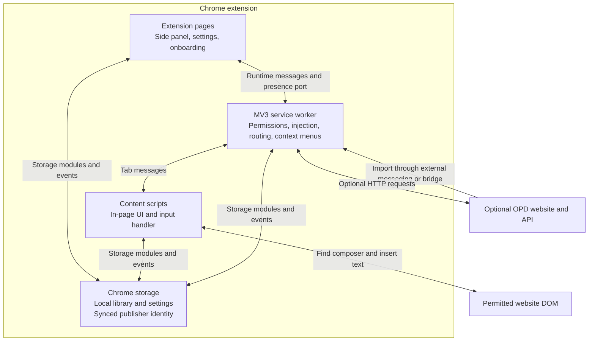
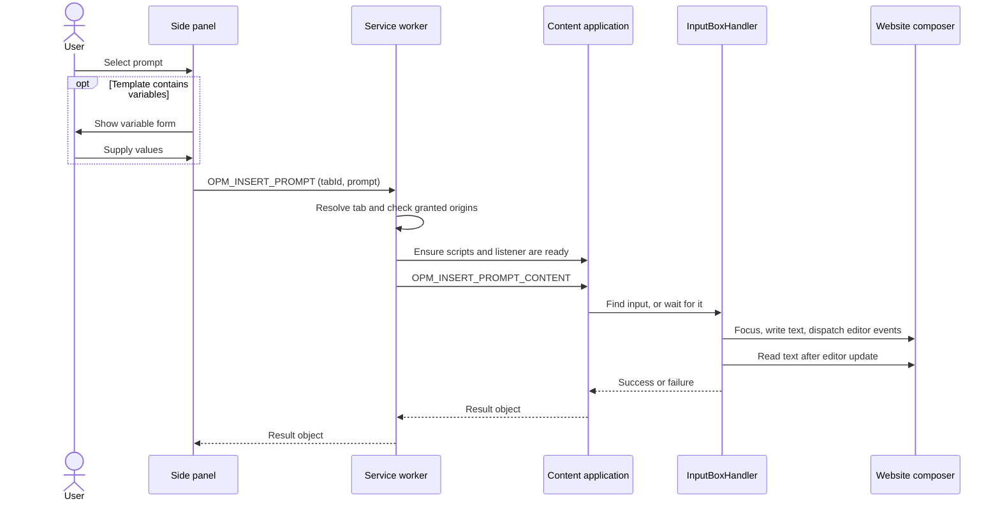

# Open Prompt Manager architecture

Open Prompt Manager (OPM) is a Chrome and Firefox desktop Manifest V3 extension that stores a personal prompt library and inserts selected prompts into website chat inputs. It uses plain JavaScript, HTML, CSS, Chrome extension APIs, and the browser DOM. The extension does not run a language model or call an AI provider's inference API: it writes text into the assistant website the user already has open.

This document describes the checked-in extension, whose [manifest](src/manifest.json) currently declares version **3.1.0**. Links point to implementation files in this repository. The optional community catalog, Open Prompt Database (OPD), has a separate website and backend repository.

## Contents

- [System overview](#system-overview)
- [Repository map](#repository-map)
- [Runtime and dependencies](#runtime-and-dependencies)
- [Installation, permissions, and script injection](#installation-permissions-and-script-injection)
- [User interfaces](#user-interfaces)
- [Prompt insertion](#prompt-insertion)
- [Finding and remembering chat inputs](#finding-and-remembering-chat-inputs)
- [Storage and data model](#storage-and-data-model)
- [Messages and events](#messages-and-events)
- [Open Prompt Database integration](#open-prompt-database-integration)
- [Localization and presentation](#localization-and-presentation)
- [Data and execution boundaries](#data-and-execution-boundaries)
- [Lifecycle, performance, and limitations](#lifecycle-performance-and-limitations)
- [Development and extension points](#development-and-extension-points)

## System overview

Chrome and Firefox share `src/`. `platform.js` exposes `OPMApi` and `OPMPlatform`, preserving native Chrome behavior while adapting Firefox promises, callbacks, sidebar controls, and publishing consent. `npm run build` creates separate target manifests and packages; see [Firefox and shared browser builds](docs/firefox.md) for the Firefox 140+ target, release configuration, and catalog bridge.

OPM runs in three main extension contexts. Extension pages own the side panel, settings, and onboarding. A background service worker on Chrome, or a module event page on Firefox, coordinates browser operations and catalog requests. Content scripts own the interface injected into permitted websites and interact with their chat inputs.

These contexts communicate through Chrome messages, ports, and storage events. Extension pages and content scripts can use the shared storage modules directly; ordinary library edits do not have to pass through the worker.



The personal library lives in `chrome.storage.local`. Only publisher identity and catalog preferences use `chrome.storage.sync`; the library is not synchronized through Chrome. JSON import and export provide portable library backups.

The two repositories have different responsibilities:

| Project | Responsibility |
| --- | --- |
| **This repository: `promptmanager`** | Extension packaging, local library, browser UI, site permissions, composer detection, insertion, and the client side of catalog integration. |
| **Companion: `open-prompt-database`** | Community website and HTTP API at [openpromptdatabase.com](https://openpromptdatabase.com/). Its Cloudflare Workers, D1, and website assets are outside the extension runtime. |

## Repository map

`src/` is the installable extension root. The repository root contains developer tooling and documentation.

```text
promptmanager/
├── ARCHITECTURE.md                 This guide
├── README.md                      Product overview and installation
├── DOCUMENTATION.md               Short developer guide
├── PRIVACY.md                     Product privacy policy
├── CHANGELOG.md                   Release history
├── CONTRIBUTING.md                Contribution guidelines
├── package.json                   Development dependencies and scripts
├── eslint.config.js               Lint configuration, including classic-script globals
├── docs/                          Localization, privacy, and hosting documentation
├── tests/                         Existing Jest, Node, and browser test code
├── test-data/                     Example prompt data
└── src/
    ├── manifest.json              Manifest V3 configuration and extension version
    ├── service-worker.js          Background orchestration and message handlers
    ├── content.boot.js            Early injection guard
    ├── content.styles.js          In-page CSS, theme tokens, and shared selectors
    ├── content.shared.js          In-page prompt, tag, and settings UI helpers
    ├── content.js                 In-page application, routing, keyboard, mediator
    ├── handlers/
    │   └── inputBoxHandler.js     Composer detection, insertion, and pin picker
    ├── storage/
    │   ├── promptStorage.js       Versioned library, migrations, tags, folders, backups
    │   ├── pinnedInputStorage.js  User-selected input descriptors by hostname
    │   └── learnedInputStorage.js Successful input descriptors by hostname
    ├── sidepanel/
    │   ├── index.html            Side panel and expanded-tab markup
    │   ├── sidepanel.js          Library UI, variables, assistant controls, sharing
    │   ├── styles.css            Extension-page styling
    │   └── sidepanelFooter.js    Footer navigation shared with settings pages
    ├── permissions/              Onboarding and assistant permission selection
    ├── settings.html / .js       Preferences, backup controls, and permission removal
    ├── opd-settings.html / .js   Entry point for catalog settings
    ├── opd/                      Catalog bridge, API client, import, and publishing
    ├── shared/                   Supporting shared UI helpers
    ├── llm_providers.json        Built-in assistant definitions
    ├── llm_providers.js          Cached provider loader and pattern helpers
    ├── i18n.js                   Shared application localization runtime
    ├── locales/                  Application translations and localized changelog
    ├── _locales/                 Chrome-native manifest translations
    ├── importExport.js           Thin adapter around prompt storage backup APIs
    ├── utils.js                  UUID generation
    ├── utils/                    Tags, origin patterns, icons, insertion helpers
    ├── devFlags.js               Development onboarding storage-key definition
    ├── changelog.html            Packaged in-page release notes
    └── icons/                    Bundled image and SVG assets
```

## Runtime and dependencies

### Application technology

The shipped UI has no JavaScript framework, component library, database server, or npm runtime bundle. Chrome loads the files under `src/` directly. Chrome can load `src/` directly. The dependency-free packaging script copies the shared application and generates the target manifest for each browser.

The worker and extension-page controllers use ES modules. The injected application uses ordered classic scripts that expose shared classes and helpers on `window` in the extension's isolated content-script world. Content scripts dynamically import the storage modules using `import(chrome.runtime.getURL(...))`. The manifest lists the required imported resources under `web_accessible_resources`.

This mixed loading model matters when moving code: an ES-module export is not automatically available to classic scripts, and a classic-script global does not become an importable module export.

### Chrome APIs

| API or capability | How OPM uses it |
| --- | --- |
| `chrome.sidePanel` | Hosts the main library, configures toolbar-click behavior, opens the panel, and optionally observes panel open/close events. |
| `chrome.storage.local` | Stores the prompt library, ordinary preferences, provider metadata, and remembered inputs. |
| `chrome.storage.sync` | Stores the pseudonymous publisher token, handle, sharing preference, and optional API base URL. |
| `chrome.tabs` / `chrome.windows` | Finds the relevant browser tab and window, opens assistant/catalog pages, delivers messages, and supports an injection reload fallback. |
| `chrome.scripting` | Registers content scripts for granted sites and injects scripts into already-open tabs. |
| `chrome.permissions` | Requests, inspects, and removes optional website access. |
| `chrome.runtime` | Worker lifecycle events, internal/external messaging, presence ports, and packaged-resource URLs. |
| `chrome.contextMenus` | Provides prompt insertion and saving selected text from the page context menu. |
| `chrome.i18n` | Supplies the browser UI language used for automatic application language selection. |
| `chrome.dom.openOrClosedShadowRoot`, when available | Helps find inputs inside known shadow hosts; the handler falls back to open `shadowRoot` access. |

The manifest declares `sidePanel`, `storage`, `tabs`, `scripting`, `activeTab`, and `contextMenus` permissions. It declares no required host permissions. `activeTab` is present, but the normal insertion coordinator explicitly checks granted website origins before injecting the full application.

The manifest does not declare a `minimum_chrome_version`. Compatibility depends on the Chrome extension APIs and web APIs actually used; native side-panel lifecycle events are feature-detected. Firefox uses `sidebarAction` and a module background script through its generated manifest; Chrome retains its side-panel and service-worker implementation.

### Browser and external dependencies

OPM relies on DOM events, selection/range APIs, `MutationObserver`, `matchMedia`, the Web Animations API, `fetch`, `Blob` downloads, and the Clipboard API. Rich-editor compatibility also relies on `document.execCommand` and synthetic input events.

For core library operations, no OPM server or AI API key is required. Insertion depends on access to a website with a usable input, and the website handles any eventual AI request after the user submits it.

Network use includes the optional OPD API and assistant icon images. [Provider definitions](src/llm_providers.json) mix bundled icons with remote images. [Icon helpers](src/utils/providerIcons.js) can fall back to Google's favicon endpoint, using the provider hostname. Packaged JSON, translations, and changelog HTML are fetched through extension URLs, which are local resources.

### Development dependencies

[package.json](package.json) lists Jest `^29.7.0` and Puppeteer `^24.4.0` under `dependencies`, and ESLint `^9.23.0`, `@eslint/js`, and `globals` under `devDependencies`. These support repository development and are not imported into the shipped application. See [TESTING.md](TESTING.md) and [localization documentation](docs/localization.md) for the existing test tooling.

The npm package's `version` is separate from the extension release version. Chrome reads the version in `src/manifest.json`.

## Installation, permissions, and script injection

### First installation and startup

The [service worker](src/service-worker.js) configures the toolbar action to open the side panel. On a first install it stores `displayMode: "hotCorner"` and `enableTags: true`, then opens `permissions/permissions.html`.

The [onboarding controller](src/permissions/permissions.js) lets the user choose a launcher and enable assistants. It requests host permissions inside the user's click handler. This placement also allows it to attempt `sidePanel.open` while the click's user activation is available. The worker then opens the assistant page, updates provider metadata, and marks onboarding complete.

Updates rebuild provider permission metadata and content-script registrations without automatically opening the first-install page. Worker startup also synchronizes registrations. A routine worker wake does not reopen onboarding.

### Optional host access

The manifest's `optional_host_permissions` includes `<all_urls>` and both HTTPS catalog origins. This allows individual assistant or custom-site requests; it does not itself grant access to every website.

Provider definitions contain comma-separated Chrome match patterns. [originPatterns.js](src/utils/originPatterns.js) expands and matches these patterns. `aiProvidersMap` caches display information and permission status for the UI; Chrome's actual permissions remain the authority for script access.

When permissions change, the worker updates the script registration. Revocation also updates cached provider flags and removes remembered input mappings for hostnames it can derive from the revoked patterns. Settings exposes per-origin removal controls. Revocation should not be treated as a synchronous teardown of every DOM node already injected into an open page.

### Dynamic content-script registration

There is no static `content_scripts` block in the manifest. The worker registers `opm-page-content` for currently granted origins, with `document_idle` timing and persistence across browser sessions. The OPD website is excluded because it uses a separate import bridge.

The file order is explicit and significant:

1. `platform.js`
2. `content.boot.js`
3. `i18n.js`
4. `utils/promptInsertUtils.js`
5. `handlers/inputBoxHandler.js`
6. `content.styles.js`
7. `content.shared.js`
8. `content.js`

The boot file sets `__openPromptManagerInjected` before the rest of the application loads. Other guards distinguish script loading, listener readiness, and application bootstrap:

| Guard | Meaning |
| --- | --- |
| `__openPromptManagerInjected` | Injection has started; the application may still be loading. |
| `__OPM_CONTENT_SCRIPT_LOADED__` | The main content application has entered its guarded load block. |
| `__OPM_CONTENT_READY__` | The prompt-insertion listener has been registered. |
| `__OPM_INITIALIZED__` | UI bootstrap has started. |
| `__OPM_INSERT_LISTENER__`, `__OPM_PIN_LISTENER__` | Prevent duplicate message-listener registration. |

Registered scripts handle subsequent navigations. For existing tabs, the worker uses `executeScript` and checks readiness. Insert and pin actions can reload a tab once if injection fails or a handler is missing, then retry. This is an implemented recovery behavior and can affect an open page's unsaved state.

Injection targets the main frame by default. The current configuration does not declare an all-frames injection strategy.

## User interfaces

### Side panel and expanded tab

[sidepanel/index.html](src/sidepanel/index.html) and [sidepanel.js](src/sidepanel/sidepanel.js) provide the prompt list, create/edit form, search, tags, variable form, copy/delete/share actions, assistant shortcuts, and custom-site controls.

The same HTML supports a full-tab layout through `?expanded=1`. Its controller moves the composer into the expanded layout rather than using a separate application. The expanded tab does not establish side-panel presence; when it is the active tab, it is an extension page rather than an HTTP(S) insertion target.

Initialization reads prompts, provider metadata, pins, and tag preferences together. The prompt list is painted before secondary tag and assistant controls, which can be scheduled with `requestIdleCallback`. A display signature avoids rebuilding the list when a storage update only changes publishing metadata. The UI also avoids replacing the list while the variable form is active.

The actual side panel opens an `opm-sidepanel` runtime port and sends its window ID. The worker broadcasts whether that window's side panel is open. Content scripts hide their in-page launchers and disconnect the launcher-recovery observer while it is open, then restore them when it closes. Native side-panel events provide an additional signal when available.

### In-page application

The injected UI lives under `#opm-root` in the website DOM. It uses namespaced classes, IDs, and CSS variables; it does not wrap its interface in a shadow root. The JavaScript is isolated from page scripts, but the UI still shares the host document and can be affected by website layout or styling.

The main responsibilities in [content.js](src/content.js) are:

| Component | Responsibility |
| --- | --- |
| `PromptStorageManager` | Adapts the shared storage module for classic-script callers and reads local UI preferences. |
| `PromptUIManager` | Mounts launchers, manages list state and selection, controls forms, and applies layout/theme updates. |
| `PanelRouter` / `PanelView` | Switches between list, create, edit/reorder, single-prompt edit, settings, changelog, and variable views. |
| `KeyboardManager` | Handles the recorded open/close shortcut, arrow navigation, Enter, and Escape. |
| `PromptProcessor` | Extracts and substitutes `#variable#` placeholders. |
| `PromptMediator` | Connects UI selections and worker messages to the input handler, and coordinates startup and observers. |
| `EventBus` | Carries prompt-selection events within this content-script application. |

[content.shared.js](src/content.shared.js) supplies `TagService`, `TagUI`, and `PromptUI`. Its initialization is deferred until `content.js` has exposed the globals it needs. These helpers implement tag suggestions, prompt rows, forms, reorder behavior, and in-page settings.

The launcher modes share the same underlying panel:

| Stored `displayMode` | Behavior |
| --- | --- |
| `standard` | Draggable floating button, with position persisted locally. |
| `hotCorner` | Bottom-right hover zone and indicator. This is the first-install default. |
| `invisible` | Hidden anchor for keyboard access; the browser side panel remains available. |

The shortcut is handled by a page `keydown` listener, not a manifest `commands` entry. Chrome defaults are Command+Shift+P on macOS and Ctrl+M elsewhere. Firefox defaults to Ctrl+Shift+Space. A recorded shortcut replaces that preference and modifier matching is exact.

### Settings and context menus

[settings.js](src/settings.js) controls launcher mode, append/overwrite, tags, forced dark mode, shortcut recording, language, backup import/export, library deletion, and website access removal. In-page settings use separate UI code in `content.shared.js` but share the same storage keys. Catalog identity and sharing settings have their own [page controller](src/opd/opdSettingsPage.js).

The worker builds a context-menu tree from the library. Selecting a saved prompt uses the same insertion coordinator as the side panel. Saving selected page text asks for a title through an injected native `prompt()` dialog, then calls `savePrompt`. Prompt changes trigger a debounced menu rebuild; language changes also rebuild its translated labels. Overlapping rebuild requests are serialized.

## Prompt insertion

### End-to-end side-panel flow



The panel resolves the active tab in its current window, with a last-focused-window fallback, and sends a prompt payload plus the target tab ID. Passing the payload allows substituted variable values to be inserted without saving those values into the library template.

The worker accepts either a supplied prompt or a `localUuid` to resolve from storage. It checks the target URL and granted origins, activates the tab, ensures content scripts are available, and forwards the request. Missing handlers receive bounded retries; injection/handler failures can take the single-reload recovery path described above.

The content mediator shares its selection logic between in-page clicks, keyboard selection, and worker requests. It suppresses immediate duplicate selections, finds the composer, and waits if necessary. Worker-driven insertion requests use an approximately eight-second input-discovery budget; the ordinary in-page selection path defaults to ten seconds.

### Variables

Both interfaces recognize `#name#` using `/#([a-zA-Z0-9_]+)#/g`: names contain ASCII letters, digits, or underscores. Repeated names produce one field and all occurrences are substituted. This is a simple placeholder mechanism, not a template-expression engine.

The side panel collects values before sending the insertion message. The content mediator can also display its own variable form, including for context-menu insertion. In that case an `{ ok: true, needsVariables: true }` response means the form was opened; the actual write follows submission. It resolves the composer again because the website may replace the element while the form is open.

### Writing to different editors

All paths eventually call [InputBoxHandler.insertPrompt](src/handlers/inputBoxHandler.js). `disableOverwrite: false` replaces existing input; `true` appends. The handler focuses the composer and selects an appropriate write strategy:

| Input type | Strategy |
| --- | --- |
| `textarea` or text `input` | Set `.value`, dispatch bubbling `input` and `change`, and adjust textarea height. |
| Ordinary `contenteditable` | Write text nodes or paragraph elements, move the caret, and dispatch an `input` event. |
| Recognized rich editor | Resolve the inner Lexical, ProseMirror, or Quill node and use selection, `beforeinput`, `execCommand`, and editor-specific fallbacks. |
| ChatGPT multiline ProseMirror | Escape prompt text and use one `insertHTML` transaction to preserve line breaks. |
| Perplexity/Lexical | Allow asynchronous editor commits before another attempt; avoid immediately inserting repeated copies. |

Synthetic paste is deliberately avoided on ChatGPT and Perplexity because those websites may turn it into a quote or file attachment. [promptInsertUtils.js](src/utils/promptInsertUtils.js) normalizes text and identifies/collapses repeated prompt copies caused by editor fallbacks.

After writing, the handler waits briefly for text to appear, can retry once, and checks the resulting composer text. This check uses normalized prompt snippets/prefixes; it is a heuristic rather than an exact full-document comparison or confirmation that the host framework accepted a future submission. A detected successful insertion can be saved as a learned input selector.

Insertion leaves the text in the composer. OPM does not press the assistant's Send button.

### Failure handling

Results use `{ ok: false, error: "..." }` codes such as `no_active_tab`, `no_permission`, `inject_failed`, `handler_missing`, `prompt_not_found`, `no_input`, and `insert_failed`. `no_input` also reports whether the page matched a known provider.

The side panel translates these results into feedback. A custom site with no detected input can enter the picker flow, requesting site access first if needed. A known assistant with no input shows an optional **Pick field** action so a slow-loading composer does not automatically launch the picker. Insertion success and completion of a variable form are separate stages.

## Finding and remembering chat inputs

### Provider registry

[llm_providers.json](src/llm_providers.json) is the built-in registry. Each entry has:

```json
{
  "name": "Example Assistant",
  "pattern": "*://assistant.example.com/*",
  "url": "https://assistant.example.com/chat",
  "icon_url": "icons/example.png",
  "element_selector": "textarea, [contenteditable='true'][role='textbox']"
}
```

The example is illustrative. `name`, `pattern`, `url`, `icon_url`, and `element_selector` are the actual fields used by the loader, permission UI, and input handler. Multiple origins can be represented by comma-separated patterns. The current registry includes ChatGPT, NotebookLM, Claude, Poe, Gemini, DeepSeek, Grok, Microsoft Copilot, GitHub Copilot, Kimi, Mistral Le Chat, OpenAI Playground, OpenRouter, ChatLLM, Google AI Studio, Perplexity, Qwen, and LMArena.

The registry is bundled JSON, cached per execution context. It is not a remotely updated selector service. Changes to built-in selectors ship with the extension.

### Detection order

The handler first reuses a short-lived cached element if it is still connected and usable. Otherwise it tries:

1. The user's pinned descriptor for the hostname.
2. A previously learned descriptor from a successful insert.
3. The matching provider's configured selectors.
4. Provider-specific fallback logic, including Gemini shadow-root searches.
5. Generic editable-input heuristics, also available on custom sites.

Candidates are scored using visibility, dimensions, viewport position, known editor containers, editable state, and prompt-like labels. Navigation/search inputs and inline message-edit areas are penalized. Gemini has targeted traversal of known custom elements and nested shadow roots; this is not a general iframe or arbitrary closed-component traversal system.

When no composer is ready, `waitForInputBox` combines increasing polling delays with a debounced `MutationObserver`. It disconnects its observer and clears timers when it resolves or times out.

### Explicit pins and automatic learning

The picker highlights editable elements and stores a descriptor for the clicked field. Descriptor construction prefers a unique ID, then stable attributes such as `data-testid`, `data-id`, `name`, or `aria-label`, and finally a short CSS path. A `deepShadow` flag records when deeper resolution is needed. After a selection, it inserts the queued prompt, or example text when no prompt is queued.

Pins are explicit user choices and take priority over learned inputs. A successful unpinned insertion can store a learned descriptor; stale learned descriptors are removed when they no longer resolve. Pinning removes the learned entry and invalidates the element cache. Clearing/resetting detection removes remembered mappings; the reset action can restart the picker.

Both maps are keyed by normalized **hostname**, not URL path, scheme, or port. Different applications or composers on the same hostname share a mapping, and a website redesign can invalidate it.

## Storage and data model

### Canonical library

[storage/promptStorage.js](src/storage/promptStorage.js) is the shared API for library reads and writes. It normalizes prompts, manages schema migration, mirrors the legacy array, handles folders and tags, and builds backups.

The canonical `chrome.storage.local` value is `prompts_storage`:

```json
{
  "version": 2,
  "prompts": [
    {
      "uuid": "local-or-catalog-derived-id",
      "title": "Summarize a topic",
      "content": "Summarize #topic# in three paragraphs.",
      "createdAt": "2026-11-11T10:00:00.000Z",
      "tags": ["writing"],
      "folderId": null
    }
  ],
  "folders": []
}
```

Prompts can additionally carry `updatedAt`, `opdPublicId`, and `opdLastPublishedAt`. IDs prefer `uuid`, then a legacy `id`, then a generated UUID. Tags are trimmed, lowercased, deduplicated, and stripped of blank values. Normalization retains the supported fields rather than arbitrary extra properties.

Folders contain `id`, `name`, `parentId`, `createdAt`, and optional `updatedAt`. The storage API supports folder CRUD and moving prompts; deleting a folder detaches its directly assigned prompts. The primary UI is currently a flat prompt list with tags, rather than a complete folder-tree browser.

Reads migrate a legacy `prompts` array into the versioned store. Stores with a version different from `PROMPT_STORAGE_VERSION` are normalized to the current shape, and tag normalization can also trigger a rewrite. Writes save the canonical store and a legacy `prompts` mirror in one `chrome.storage.local.set` call.

Prompt order is the array order. Reorder operations persist a replacement list. Most mutations read the current list, change it, and write it back; there is no cross-context transaction or global write queue. Concurrent edits from multiple interfaces can therefore overwrite one another.

### Main storage keys

| Area | Key | Purpose |
| --- | --- | --- |
| Local | `prompts_storage` | Canonical v2 library. |
| Local | `prompts` | Legacy prompt-array mirror. |
| Local | `pinned_inputs_v1` | Hostname-to-descriptor map with selector, label, `deepShadow`, and `pinnedAt`. |
| Local | `learned_inputs_v1` | Similar map with `learnedAt` and `successCount`. |
| Local | `aiProvidersMap` | Assistant URL/pattern/icon metadata and cached `"Yes"`/`"No"` permission flags. |
| Local | `displayMode`, `buttonPosition` | Launcher type and floating-button position. |
| Local | `keyboardShortcut` | Key, modifier, and Shift requirement. |
| Local | `disableOverwrite`, `forceDarkMode` | Append behavior and in-page theme override. |
| Local | `enableTags`, `tagsOrder`, `activeTagFilter` | Tag UI, ordering, and shared selected filter. |
| Local | `uiLanguage` | Application language preference. |
| Local | `onboardingCompleted`, `opmDevForceOnboarding` | Onboarding and development tooltip state. |
| Local | `dismissedBanners` | Dismissed update-banner IDs. |
| Local | `opdPublisherSyncedAt` | Last publisher-identity refresh timestamp. |
| Sync | `opdPublishToken` | Random publisher credential generated with `crypto.randomUUID()`. |
| Sync | `opdPublishEnabled` | Sharing availability; defaults to enabled when absent. |
| Sync | `opdUsername`, `opdPendingUsername` | Registered public handle and draft handle. |
| Sync | `opdApiBaseUrl` | Optional override for the default catalog API origin. |

Storage events refresh prompt lists and menus, keep the selected tag filter in step, update launcher/theme/shortcut preferences, and refresh permission or publishing controls. Search text and open-form state are interface state rather than a synchronized library record.

### Import and export

The exported `opm-backup-YYYY-MM-DD.json` contains `version`, normalized `prompts`, `folders`, and `meta` with `tagsOrder`, `activeTagFilter`, and `enableTags`. Prompt publishing metadata is included when present. Publisher secrets, permissions, pins, language, and other preferences are not part of this backup.

Import accepts a `File`, JSON string, legacy prompt array, or parsed store object. It merges prompts by UUID, choosing an incoming existing-ID entry only when its `updatedAt` or `createdAt` is newer. New IDs are added. Folders merge by ID, and supported tag metadata is merged/applied. Import is a merge operation rather than a complete profile restore.

Exports use a local `Blob` and download link; they do not upload the backup. [importExport.js](src/importExport.js) delegates to the storage module rather than maintaining another backup format.

## Messages and events

The worker uses `chrome.runtime.onMessage` for internal requests, `onMessageExternal` for catalog-origin requests, and `chrome.tabs.sendMessage` to reach content scripts. Asynchronous listeners return `true` to keep the response channel open while work completes.

| Message or port | Direction | Purpose |
| --- | --- | --- |
| `OPM_INSERT_PROMPT` | Extension page → worker | Resolve prompt/tab, check access, and coordinate insertion. |
| `OPM_INSERT_PROMPT_CONTENT` | Worker → content script | Run the shared prompt-selection/insertion flow. |
| `OPM_PIN_INPUT` | Extension page → worker | Coordinate `start`, `cancel`, `clear`, `reset`, or `status` for the picker. |
| `OPM_PIN_INPUT_CONTENT` | Worker → input handler | Run the pin action inside the content-script context. |
| Port `opm-sidepanel` / `OPM_SIDEPANEL_HELLO` | Side panel → worker | Announce side-panel presence and its browser window. |
| `OPM_SIDE_PANEL_STATE` | Worker → permitted tabs | Hide or restore the in-page launcher in that window. |
| `OPM_LAUNCH_PROVIDER_ONBOARDING` | Onboarding → worker | Open an enabled provider and attempt to show the panel. |
| `OPM_CLOSE_EXPANDED_TAB` | Expanded page → worker | Close the sending extension tab. |
| `OPD_PING` | Catalog webpage → worker, external | Report extension presence/version. |
| `OPD_IMPORT_PROMPT` | Catalog external message or bridge → worker | Merge a selected catalog entry into the local library. |
| `OPD_PUBLISH_STATUS`, `OPD_PUBLISH_ENABLE` | Extension page → worker | Read publisher state or change sharing availability. |
| `OPD_HANDLE_AVAILABLE`, `OPD_PUBLISH_REGISTER` | Extension page → worker | Check or register a public handle. |
| `OPD_PUBLISH_PROMPT`, `OPD_PUBLISH_DELETE` | Extension page → worker | Publish/update or unpublish a selected local prompt. |

`chrome.storage.onChanged` is the separate notification path for persisted state. The small content-script `EventBus` is only an in-page implementation detail; it is not the transport between Chrome contexts.

## Open Prompt Database integration

The catalog is optional for managing and inserting a personal library. Its implementation under [src/opd/](src/opd/) has these responsibilities:

| Module | Responsibility |
| --- | --- |
| `opdConstants.js` | Canonical catalog URL, store extension ID, and publishing message names. |
| `opdCatalogAccess.js` | Catalog-origin checks, optional host access, bridge registration, and injection into existing catalog tabs. |
| `opd-bridge.js` | Relay between the webpage's `postMessage` requests and internal runtime messaging. |
| `opdImport.js` | Catalog payload validation, local-ID mapping, duplicate detection, and library merge. |
| `opdClient.js` | HTTP requests, JSON parsing, token headers, and catalog API endpoints. |
| `opdPublishToken.js` | Synced publisher credentials/preferences and local refresh timestamps. |
| `opdPublisher.js` | Handle suggestions, registration, cached identity, and server refresh. |
| `opdPublish.js` | Publish/update/fork/unpublish behavior and local publication metadata. |
| `opdSettingsPage.js` | Catalog access, draft/registered handle, and sharing settings UI. |

### Import channels

There are two ways a catalog page can request an import:

1. **External messaging:** the webpage calls `chrome.runtime.sendMessage` using the store extension ID. `externally_connectable.matches` permits the catalog's HTTPS apex and `www` URLs, and the worker independently checks the sender URL. Its external handler accepts `OPD_PING` and `OPD_IMPORT_PROMPT`.
2. **Optional content bridge:** after catalog host access is granted, `opd-catalog-bridge` runs at `document_start`. The webpage sends `OPD_REQUEST_IMPORT` through `window.postMessage`; the bridge checks that the event came from the same window, forwards `OPD_IMPORT_PROMPT`, and posts `OPD_IMPORT_RESULT` with the request ID. It marks `document.documentElement.dataset.opmBridge` for discovery. This supports unpacked installs whose ID differs from the store ID.

The normal assistant launcher bundle is excluded from the catalog site. The bridge is a separate registration with separate behavior.

Catalog-origin helpers recognize `localhost:8787` and `127.0.0.1:8787` for development, but the checked-in manifest's external connection allowlist and the bridge's registration origins contain only the production HTTPS catalog hosts. Helper recognition alone does not enable a localhost development connection.

### Import identity and counting

The import mapper requires a catalog ID, title, and content. It normalizes tags and maps the entry to `uuid: "opd:<catalogId>"`, also storing `opdPublicId`.

An identical title/content/tag set returns `already` without a library write. A changed catalog payload updates the same local ID; a first import returns `imported`. The worker sends a nonblocking import-count request only for that first-import status. A failed counter request does not undo the local import.

These imports are snapshots. The extension does not continuously synchronize its entire library with the catalog. Re-importing a changed catalog entry can replace the corresponding imported row.

### Publishing and publisher identity

Publishing uses a random token in Chrome sync storage as a pseudonymous credential. [opdClient.js](src/opd/opdClient.js) sends it as `X-OPD-Token` when present. There is no email/password sign-in in the extension flow. The public handle is stored separately from the secret.

Sharing availability defaults to enabled when `opdPublishEnabled` is absent. This does not automatically publish the library. The user selects a prompt's Share action, which requests catalog host access, asks the worker to publish that prompt, and copies the resulting catalog URL when clipboard access succeeds.

A draft handle can be suggested or chosen before registration. On the first upload, the publisher module ensures that a handle is registered, retrying suggestions on collisions. Existing publisher identity is cached with a 24-hour refresh interval; a forced status request can refresh it earlier. Registration locks the handle in the current settings UI.

Publication behavior depends on the existing catalog link:

- An owned catalog entry is updated using its existing ID.
- An imported entry owned by someone else is published as a new entry for the current publisher. If the local row still uses an `opd:` UUID, it receives a new local UUID so later imports of the source entry do not overwrite that published copy.
- A known catalog lookup failure other than `404` stops sharing rather than blindly creating another row.
- Successful publishing records `opdPublicId` and `opdLastPublishedAt` locally. Unpublishing calls the delete endpoint and clears those fields; it does not remove the personal prompt.

The client supports forwarding an optional Turnstile token in the request header and body. Challenge enforcement and the catalog database are server responsibilities in the companion project.

### API surface used by the extension

The API base defaults to `https://openpromptdatabase.com` and can be overridden with `opdApiBaseUrl`. An override does not automatically update host permissions or external-message/bridge allowlists.

| Method and path | Use |
| --- | --- |
| `GET /v1/handles/:handle/available` | Check handle availability. |
| `POST /v1/publishers` | Register a public handle for the token. |
| `GET /v1/publishers/me` | Resolve publisher identity from the token. |
| `GET /v1/prompts/:id` | Inspect a known entry before deciding how to share it. |
| `POST /v1/prompts` | Publish or update a selected prompt's title, content, tags, and optional ID. |
| `DELETE /v1/prompts/:id` | Unpublish an entry. |
| `POST /v1/prompts/:id/import` | Notify the catalog of a first local import. |

Catalog browsing happens on the website; the extension does not implement the website's catalog search/indexing backend.

## Localization and presentation

[i18n.js](src/i18n.js) is shared by extension pages, content scripts, and the worker through `globalThis.OPMI18n`. Application catalogs cover English, Spanish, French, Portuguese, and Simplified Chinese. `uiLanguage` accepts those locale codes or `auto`; automatic selection follows the browser language with English fallback.

`OPMI18n.ready` gates initial dynamic UI construction. Static markup uses explicit `data-i18n` attributes, while JavaScript-created nodes use `bind`, `apply`, or `t`. Injected UI registers its own roots so translation does not traverse the host website. Language loads guard against stale responses, missing keys fall back to English, and extension pages have a visibility fallback if localization cannot initialize.

Rich translated sentences reuse named link/emphasis nodes rather than interpreting translations as HTML. User prompt text, tags, variable names, and handles remain data. Chrome-native extension name/description strings come from `_locales/*/messages.json`, separately from the application catalogs. Simplified Chinese also has a packaged localized changelog. See [docs/localization.md](docs/localization.md) for the full conventions.

In-page styles and tokens live in `content.styles.js`; extension-page styling lives in `sidepanel/styles.css`, with additional onboarding styles under `permissions/`. The in-page theme follows `prefers-color-scheme` unless forced dark mode is enabled. The UI manages its own scroll visibility and panel-resize animations. Settings and in-page controls share preferences, but their markup/rendering implementations remain separate.

## Data and execution boundaries

The main boundaries are explicit in the source:

- **Personal library:** stored in Chrome local storage for this extension/profile. Saving, editing, searching, and backing up prompts do not upload the library to OPD.
- **Website interaction:** granted content scripts inspect editable DOM elements and write the selected text into the composer. They do not need the website's internal JavaScript objects or an AI provider SDK. Once text is submitted on that website, its own request handling applies.
- **Catalog import:** only the external import/ping surface is exposed to the allowed catalog origins. Publishing requests use internal extension messages. Imports validate the required prompt fields and store normalized data.
- **Catalog publishing:** selected prompt text and tags leave the device in a publish request. Publisher tokens identify API operations and must be treated as credentials; they are not included in normal JSON backups.
- **Presentation resources:** provider icons can generate requests to third-party image/favicon hosts. Translation files, scripts, and changelog HTML are packaged extension resources rather than downloaded executable application code.

The source includes no extension analytics or advertising integration. The product's broader privacy commitments are documented in [PRIVACY.md](PRIVACY.md).

## Lifecycle, performance, and limitations

The worker is event-driven. Durable state belongs in Chrome storage or persisted content-script registrations. Worker globals such as origin caches, panel-window tracking, and rebuild state belong to that worker lifetime; they are not a persistent database. Presence ports and available native events report side-panel state, but should not be mistaken for a permanent background process.

Content-script state belongs to the current document. Navigation recreates it. Single-page applications may replace composers or injected nodes without a full navigation, so OPM uses input-cache validity checks, bounded input discovery, and a debounced launcher-recovery observer. It cleans up transient tag, shortcut-recording, and reorder listeners during view replacement. The recovery observer is paused while the side panel is open.

Other measures include cached provider JSON, a short input-element cache, debounced searches and menu rebuilds, parallel storage reads, deferred secondary side-panel rendering, and avoiding metadata-only list redraws. Library searches are local substring/tag filtering; there is no extension-side search server or database index.

Current constraints to account for when extending the project:

- Website DOM/editor behavior is an external dependency. Selector changes, rich-editor updates, or rejected synthetic events can break insertion without any OPM API changing.
- A detected insert is based on visible-text heuristics, not a guarantee about the website's internal state or a completed AI request.
- Main-frame injection and targeted shadow traversal do not provide universal support for inputs inside arbitrary iframes/components.
- CSS is namespaced but shares the host document; it is not fully style-isolated.
- Hostname-level input mappings cannot independently describe every route, port, or composer on one host.
- Local storage uses whole-list read/modify/write operations, without transactional conflict resolution. The legacy prompt mirror also stores another copy of the library data.
- Chrome storage quotas and memory/rendering costs still apply; the manifest does not request `unlimitedStorage` and the library is not paginated by a backend.
- Library backups do not restore the entire extension profile or publisher credential. Disabling sharing does not itself unpublish existing entries.
- Existing-tab recovery may reload a page. Restricted browser pages and extension pages are not normal insertion targets.

## Development and extension points

### Working from source

The extension root is `src/`, as described in the [README](README.md#load-from-source-development). Node/npm are needed for repository tooling, not to compile the extension before loading it. Distribution packages must place `manifest.json` and the other `src/` contents at the extension package root.

The current `build:prod` npm script references `src/manifest.prod.json`, which is not present in this checkout. It is not a required source-build pipeline. Use the checked-in manifest as the description of what is actually shipped; release packaging and version updates must keep it consistent with the documentation.

### Where to make changes

| Change | Main implementation points |
| --- | --- |
| Add an assistant or adjust selectors | `llm_providers.json`; extend `inputBoxHandler.js` only when its editor needs special treatment. |
| Add an editor strategy | Detection, selection/write helpers, and success handling in `handlers/inputBoxHandler.js`; pure text helpers in `utils/promptInsertUtils.js`. |
| Add a library field or change the schema | Normalization, `PROMPT_STORAGE_VERSION`, migration, CRUD, and backup behavior in `storage/promptStorage.js`. |
| Add a launcher/view | `content.styles.js`, `PromptUIManager`, `PanelView`, and `PanelRouter`; keep both settings surfaces consistent. |
| Change a preference | Shared storage key/defaults, `settings.js`, in-page settings, and the relevant storage listeners. |
| Add a side-panel action | `sidepanel.js`; use worker routing if it needs a tab or background operation. |
| Add an internal message | Worker handler, caller, and relevant content listener; preserve asynchronous response-channel handling. |
| Change catalog access or origin | Manifest external/optional-host declarations, `opdConstants.js`, catalog-access helpers, and script exclusions. |
| Change catalog import/publishing | The relevant `src/opd/` modules, shared prompt metadata, and the companion API contract. |
| Add a locale or UI string | Application catalogs, native `_locales` where relevant, locale resolution/selectors, and explicit UI bindings. |

Keep library mutations behind the shared storage module, distinguish cached UI permission flags from Chrome grants, preserve content-script load order, and treat external catalog IDs separately from local prompt IDs when changing publishing behavior. Historical planning files such as `plan-open-prompt-database.md` describe earlier intentions; the current implementation is the source for this architecture.
